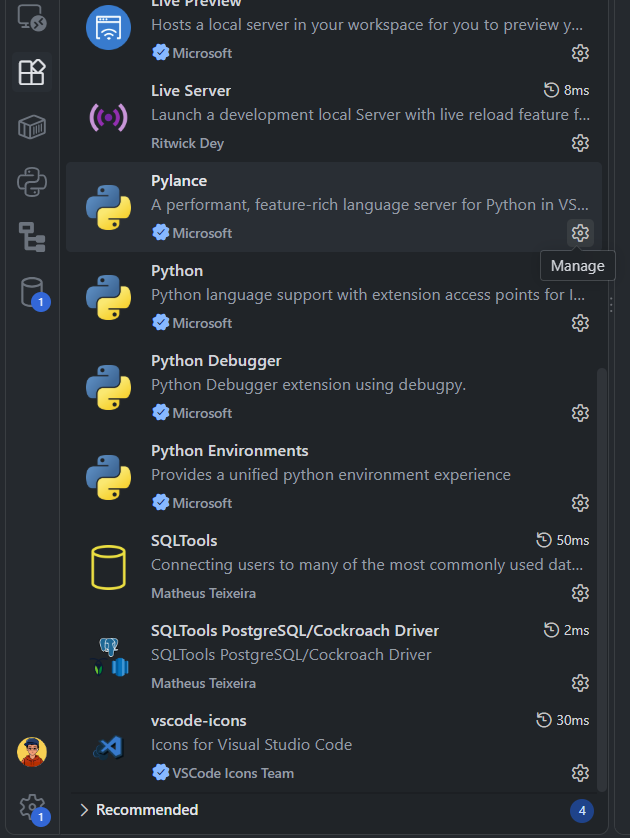

# Setup for PostgreSQL to Run Locally

We have multiple ways of setting up a Postgres database:

| Option | What it is | Good for |
|--------|-----------|----------|
| **1. Docker container** | Run Postgres in a container from the terminal | Fastest setup, closest to how production works |
| **2. Third-party software** | Install software that bundles Postgres and provides the UI, connection handling and everything else necessary | Beginners who prefer a GUI |
| **3. Cloud provider** | Set up a hosted database with a third party such as [Neon](https://neon.tech) | No local install, accessible from anywhere |

Here we will proceed with the **first option**, since it gives the overall idea of how real production setups run their databases in a cloud system.

---

## Things we need before proceeding

### 1. Docker installed and running

Check that Docker is installed:

```bash
docker --version
```

If you are on Windows or Mac, Docker Desktop must also be **running** before any `docker` command works (on Windows, with the WSL 2 backend enabled).

### 2. A terminal to run Docker from

In order to run Docker via the terminal, I used WSL Fedora, as it provides a smoother experience on Windows. Choose any of the options below:

| Your system | Terminal to use |
|-------------|-----------------|
| Windows | **WSL** (Fedora, Ubuntu, etc.), or **Git Bash** |
| Mac / Linux | Your native terminal, you just need to install Docker |

If you have been using Git you already know Git Bash. If not, install it, as it provides native Linux commands for creating directories and files, and for using Git to push your code to GitHub.

The terminal gives the best experience of how an actual production environment works. Do explore WSL and Linux: every machine in the cloud runs Linux, and one day you will be using a Linux terminal, so better to start now.

> **Linux note:** if you get a "permission denied" error, you need `sudo` before the command, as Docker requires admin access. To avoid typing `sudo` every time, add your user to the `docker` group (`sudo usermod -aG docker $USER`) and log out and back in.

### 3. VS Code with two extensions

We will use VS Code for writing our SQL, so install:

* **SQLTools**
* **SQLTools PostgreSQL/Cockroach Driver**

---

## Step 1: Start the Postgres container

Run this command in your terminal:

```bash
docker run -d --name sql_cc \
  -e POSTGRES_PASSWORD=postgres \
  -p 5432:5432 \
  -v sql_cc_data:/var/lib/postgresql \
  postgres:18
```

This starts a container in the background, running Postgres 18 on `localhost` port 5432, with the name `sql_cc`. Here is what each part does:

| Part | Meaning |
|------|---------|
| `-d` | Run the container in the background |
| `--name sql_cc` | Give the container the name `sql_cc` |
| `-e POSTGRES_PASSWORD=postgres` | Set the password for the `postgres` user. Fine for local learning, never use this in production |
| `-p 5432:5432` | Expose the database on `localhost` port 5432 |
| `-v sql_cc_data:/var/lib/postgresql` | Store data in a Docker volume, so your databases are not lost if the container is deleted |
| `postgres:18` | The image and version to run |

> **Important: the volume path depends on the Postgres version.**
>
> | Version | Volume mount |
> |---------|--------------|
> | `postgres:18` and newer | `-v sql_cc_data:/var/lib/postgresql` |
> | `postgres:17` and older | `-v sql_cc_data:/var/lib/postgresql/data` |
>
> Using the wrong path on 18 makes the container fail to start. Using the wrong path on 17 or older is worse: the container runs normally, but your data is **not saved** once the container is removed. This is also why we write `postgres:18` instead of `latest`, so the volume path always matches the version you run.

> **Port already in use?** If something else on your machine is using port 5432, map a different host port, for example `-p 5433:5432`, and use `5433` when connecting later.

### Check that it is running

Run:

```bash
docker ps
```

You will see `sql_cc` in the list, which means the server is running on your localhost port 5432. Now we can create our database inside this container.

> **Note:** Docker is not a full virtual machine. A container is a lightweight, isolated process that shares your operating system's kernel, so it runs separately from everything else on your computer while still using your computer's resources. (On Windows and Mac, Docker Desktop runs a small Linux virtual machine underneath to make this possible, which is why people often call Docker a virtual machine.)

---

## Step 2: Create a database

We have to go inside that container in order to create a database. Run:

```bash
docker exec -it sql_cc psql -U postgres
```

This opens `psql`, the Postgres command-line shell, running inside the container. Now we are inside the container and we can run SQL. Create a database with this command (the semicolon at the end is required, otherwise `psql` keeps waiting for more input):

```sql
CREATE DATABASE database_name;
```

We can create multiple databases inside our container. A few useful `psql` commands:

| Command | What it does |
|---------|--------------|
| `\l` | List all databases |
| `\q` | Exit the `psql` shell |

---

## Step 3: Connect from VS Code

We cannot really use the terminal to run every SQL query for creating tables and all those SQL commands. It is not that we cannot, it is just that it is not fast, and after the terminal session is over you would not have any commands left. So we will use VS Code for writing.

After installing the two extensions, we will connect to our Postgres server. Click on the cylinder, choose **PostgreSQL** and fill in the info:

| Field | Value |
|-------|-------|
| Server | `localhost` |
| Port | `5432` (or the port you mapped) |
| Database | The database name you created |
| Username | `postgres` |
| Password | `postgres` |

Click **Test Connection**, then save.

----



After a successful connection we are ready to run our SQL commands, create tables and all those things.

---

## Step 4: Stop and start the server

After you are done writing, we need to know how to stop and start the server:

```bash
docker start sql_cc
docker stop sql_cc
```

Here `sql_cc` is the name that we gave to the container.

> **Note:** `docker ps` only shows running containers, so after `docker stop` the container disappears from it. Use `docker ps -a` to see stopped containers too.

---

And that's all set to run your database locally. You can now proceed with the other `.sql` files in the `SQL` folder to understand and learn SQL.